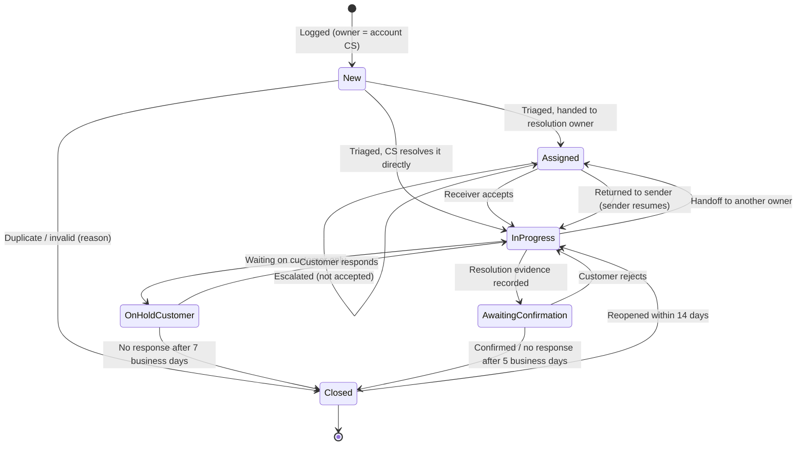

# Phase 2 — End-to-End Process Design

Revision: v1.1 — walkthrough fixes F-1…F-8, F-10 applied (marked †; see `04_phase4/design_review.md`).

Diagram: `complaint_lifecycle.mmd` (rendered: `complaint_lifecycle.png`). SLA targets: `sla_matrix.md`.
Case types and the classification order come from `01_phase1/classification_matrix.md` and are reused unchanged.
All rules here are **proposals** for validation with PadCare `[A-07]`.

## 0. The process at a glance

| Stage | Steps | Who | Status after the stage | Main challenge(s) addressed |
|---|---|---|---|---|
| **ST1 Intake** | 1.1 Receive · 1.2 Log · 1.3 Validate customer and site | Whoever receives the issue | `New` | C-01 |
| **ST2 Triage** | 2.1 Related-record search · 2.2 Classify · 2.3 Duplicate / split check · 2.4 Recurrence check · 2.5 Severity · 2.6 Acknowledge the customer | CS (communication owner) | `New` → `Assigned` | C-02, C-03, C-08, C-07 |
| **ST3 Route and assign** | 3.1 Route by type · 3.2 Handoff · 3.3 Accept or return | CS → receiving owner | `Assigned` → `In Progress` | C-04 |
| **ST4 Resolve** | 4.1 Investigate and act · 4.2 Further handoffs · 4.3 Escalate on timers or events · 4.4 Record resolution evidence | Resolution owner | `In Progress` (`On Hold – Customer` allowed) | C-04, C-05 |
| **ST5 Verify and close** | 5.1 Share the resolution, request confirmation · 5.2 Confirm / reject / no response · 5.3 Close · 5.4 Reopen or recurrence | CS | `Awaiting Confirmation` → `Closed` | C-05, C-07 |
| **ST6 Learn** (continuous) | Every step writes a timestamped event | System | — | C-06 |

---

## ST1 — Intake

### 1.1 Who logs, by channel

**Rule: whoever at PadCare receives the issue logs it in PadCareOne.** Forwarding to someone else does not count as logging.

| Channel (brief) | Who logs | When (target, see SLA R1) | Notes |
|---|---|---|---|
| WhatsApp from SPOC to their CS contact | That CS person | Within 2 business hours of receipt | Screenshot attached as evidence (optional) |
| Email to the generic support inbox | CS on inbox duty (rota) `[A-09]` | Within 2 business hours | Email text pasted; email subject kept as reference |
| Phone call to CS | CS who took the call | During or straight after the call | — |
| Raised during a CS check-in call | CS making the call | Straight after the call | One check-in call can produce several cases (split rule) |
| Escalation from KAM after a difficult client interaction | **KAM logs it** (no forwarding emails) | Same business day | Reporter = the client person who raised it. Their seniority is recorded as a contact role only; it is **not an input to severity** (C-08) |
| Verbal report to an SE on site | SE, using a quick log on mobile `[A-05]` | Before leaving the site | Fallback if there is no mobile access: SE calls CS, and CS logs it with channel = "SE on site" |

### 1.2 Log — minimum fields (fast step)

The Log step is meant to take about 2 minutes. Everything else is completed at Triage `[D-15]`.
Mandatory at Log: customer account, site, reporter (name, contact, role), channel, date/time received (defaults to now and can be backdated), customer's words (verbatim), and the logger's best-guess type.
*Full field specification: Phase 5.*

If CS already replied informally before logging (e.g., "checking" on WhatsApp), the logger records **"customer already acknowledged at [time]"**. This is kept as a customer update, but only an acknowledgement that includes a case reference counts towards R3 † (F-10).

On save:
- Case ID generated.
- Status `New`.
- **Resolution owner = the account's named CS owner** `[A-09]`. If that person is marked unavailable (leave), the city CS queue owns it.

**A case is never ownerless, even at `New`.** This is the direct fix for C-01's "if that person is on leave, it's gone".

### 1.3 Validate customer and site

| Result | Handling | Type |
|---|---|---|
| Customer and site found, and the site belongs to the customer | Continue | — |
| Site not found / the customer says the site moved (S-02) | Log with an **"Unverified site"** flag. CS resolves it at Triage: pick the correct site, or request a master-data correction `[A-18]` | Warning (does not block logging) |
| Site belongs to a different customer | Block; choose the right customer or site | Hard error |
| Customer not found | Log against an **"Unmatched customer"** placeholder with the name as stated; **Triage cannot complete until matched** † (Phase 5 review: blocking here would lose the issue, C-1) | Warning at Log; hard error at Triage |

**Why the site flag is only a warning:** blocking at Log would mean the issue never gets recorded (C-01). Data quality is fixed one step later, at Triage.

---

## ST2 — Triage (CS)

### 2.1 Related-record search (automatic, shown before classification)

On opening a `New` case, the system shows:
- **Open cases** at this site (any type);
- **Cases at this site in the last 90 days** with the same category (any status);
- For the account: **open account-level concerns** and **open cases at other sites of the account**.

### 2.2 Classify

Use the ordered questions from Phase 1:

1. Is the customer asking about an issue they already raised? → status enquiry
2. Do they want an account-level response, or report a trend across sites? → account-level concern
3. Is it about an invoice, charge, payment or credit? → billing complaint
4. Do they want PadCare to fix something it already committed to? → operational complaint
5. Is it a new or changed request? → service request

Then set the sub-category.

- **Status enquiry branch:** a follow-up is added to the parent case, and its priority is raised (flag "customer chased"). CS sends an update within the acknowledgement target. **No new case is created.**
  - If the parent is **closed**, the reopen rules in §5.4 apply.
  - If **no parent exists**, the underlying case is created with the customer-stated report date and the flag **"Not logged at receipt"**. This counts against C-01.

### 2.3 Duplicate and split check
- **Duplicate** (same incident already open): the new record closes as `Closed – Cancelled (Duplicate)` and is linked to the parent. The new reporter is added as a contact on the parent.
- **Split** (a second independent need with a different owner or closure condition, e.g., S-03): a linked case is created.

### 2.4 Recurrence check
If the same site has **≥ 2 earlier cases in the same category within 90 days**, the case is marked **Recurrence (n-th)**:
- the recurrence count is shown to everyone handling it;
- the severity escalator applies (2.5);
- a mandatory root-cause note is required at resolution.

This turns "the third bad-odour complaint" (C-02) into a visible, rule-driven event.

### 2.5 Severity (impact-based) and priority

**Severity levels** `[D-04]`. Applies to operational complaints, billing complaints and account-level concerns. Service requests have a requested-by date instead `[D-17]`.

| Level | Definition (observable test) | Examples from the brief |
|---|---|---|
| **Hygiene-Critical** | A hygiene or health exposure **exists at the site now**: waste uncollected beyond schedule with units full, overflowing units, a damaged or leaking unit, contamination | S-01 (if units are full or overdue), the overflow half of S-03 |
| **Service-Impacting** | PadCare failed an agreed service, **without** a current hygiene exposure; **or** an invoice the customer cannot act on: wrong amount, or wrong entity/site/address that stops them processing it † (F-1) | Late visit with units not yet full, unit not cleaned properly, SE conduct, S-02 |
| **Low-Impact** | No service, hygiene or financial consequence | Cosmetic issues; an invoice error that does **not** stop the customer processing it (e.g., a typo in the contact name); a commercial query with no service failure |

**Escalators.** Each raises the level by one, capped at Hygiene-Critical:
- **Recurrence:** the 3rd or later case at the site for the same category within 90 days (2.4).
- **Scope:** the same issue at **3 or more sites** of one customer.
- **Duration:** missed collection overdue by **≥ 3 days** past its scheduled date `[A-08]` (threshold to be validated per site type).
- **Billing cap † (F-12):** billing complaints never exceed **Service-Impacting** (there is no hygiene exposure). A billing recurrence or a multi-site billing issue instead **escalates**: Finance escalation contact + KAM informed.

**Who decides.**
- The system **proposes** a level from CS's answers to the impact questions: Is there a hygiene exposure now? How many sites/users are affected? Is the service commitment broken? *(Billing:)* Is the amount wrong, or can the customer not process the invoice? † Recurrence and duration are filled in automatically from history and the schedule `[A-02]`.
- CS **confirms** the level.
- CS may raise it, with a reason.
- **Lowering Hygiene-Critical** requires a reason and is visible to the Ops City Manager.
- **Reporter seniority, the customer's tone and account revenue are not inputs** (C-08). The customer's wording ("it's a hygiene issue") triggers the impact question but does not set the answer.

**Account-level concerns** take the **highest severity among the open cases at the account's sites**. If there are none, they are `Service-Impacting` for a quality trend and `Low-Impact` for a commercial topic.

**Priority** = the order in which a queue is worked. It is computed, not chosen:
1. Severity;
2. SLA state (breached > at risk, meaning less than 25% of the time is left > on track);
3. Flags: resolution rejected, customer chased, recurrence;
4. Received time (oldest first).

A KAM or Ops City Manager can set an **Expedite** flag, but only with a mandatory reason. Its use is reported, so escalation by influence becomes visible rather than hidden.

### 2.6 Acknowledge the customer
CS sends: case reference, the type as the customer would understand it ("a missed collection complaint", "a request for an additional unit"), the next step, and when they'll hear back. The update is logged on the case.

---

## ST3 — Route and assign

### 3.1 Routing by type

| Case type | First resolution owner after Triage | Typical further handoffs | Escalation contact |
|---|---|---|---|
| Operational complaint | **Hygiene-Critical: Ops City Manager**, with the SE visit as a linked task † (F-4). **Otherwise:** the SE scheduled for the site `[A-02]`, else the Ops City Manager to dispatch. CS keeps it if it can be resolved by a call (e.g., conduct explanation) | SE → CS (evidence) | Ops City Manager; KAM is notified for KAM accounts at Hygiene-Critical or the 3rd recurrence |
| Billing complaint | **Finance** | Finance → CS (outcome to communicate); Finance → master-data owner if the site record is wrong (S-02) `[A-18]` | Finance escalation contact `[A-19]`; KAM notified if a KAM account |
| Service request | **Ops City Manager** (fulfilment) | → KAM (or CS where there is no KAM) for commercial approval if charges change `[A-16]` → SE (installation) | Ops City Manager |
| Account-level concern | **KAM**; if no KAM, the Ops City Manager of the account's primary city `[A-10]` | Spawns linked child cases for specific site failures | — (already at the top of the brief's role list) |

The **communication owner stays CS** for every type `[D-16]`. CS sends all customer updates, even when Finance or an SE holds the case. The exception is account-level concerns, where the KAM may also talk to the customer directly; the updates are still logged on the case.

### 3.2 Handoff protocol (applies to every change of owner)

| Element | Rule |
|---|---|
| Sending owner / receiving owner | Both recorded |
| Reason | Mandatory, chosen from a list (e.g., "needs site visit", "invoice correction", "commercial approval", "escalation") plus free text |
| Required information | A checklist per handoff type. **CS → Finance:** invoice number, invoice month, disputed line or amount, what the customer expects, customer evidence attached; for a wrong site/address, the correct address and effective date (F-7). Finance's own checklist: **identify all invoices affected since the effective date** † (F-8). **CS → SE / Ops:** site, exact location on site (e.g., 4th floor), access contact, problem, severity |
| Assigned at / due by | Timestamped; acceptance deadline from SLA R4 |
| Acceptance | The receiver **accepts** (ownership transfers; status `In Progress`) or **returns** it with a reason (back to the sender, **status `In Progress` with the sender**, so the sender can complete the information or put the case On Hold – Customer † (F-2)). A return is not a rejection into nowhere |
| Accountability before acceptance | **The sender remains accountable until acceptance** |
| No response by the deadline | Escalated to the receiver's escalation contact. The sender is notified and stays accountable |

### 3.3 Linked tasks † (F-3)
Some work by another team does **not** need ownership to move. Examples: the SE visit for a Hygiene-Critical case owned by the Ops City Manager; a site master-data correction needed by Finance (S-02); an installation for a service request.

These are **linked tasks** inside the case:
- **Fields:** task owner, due date, done/not done, evidence.
- **The case owner stays accountable** for the case; the task owner is accountable for the task.
- Task acceptance and overdue escalation follow the handoff timers (R4, 4.3).
- **A mandatory task that is not done blocks resolution** (4.4).

*Rule of thumb:* hand off when the **next decision** belongs to another team; create a task when only a **piece of work** does.

### 3.4 Statuses during routing
`Assigned` = waiting for the receiver to accept. `In Progress` = accepted by the current owner. Each new handoff returns the case to `Assigned`.
This makes the "in nobody's inbox" period (C-04) **visible and measurable** as time spent in `Assigned`.

---

## ST4 — Resolve

### 4.1 Investigate and act — by type

| Type | Typical actions | Resolution evidence required before `Awaiting Confirmation` (system-enforced) |
|---|---|---|
| Operational complaint | Check the schedule: was the visit scheduled? marked done? → plan the visit → SE visits → fix | A visit record linked to the case **and** proof (photo of serviced unit or SPOC sign-off) **and**, for recurrences, a root-cause note **and**, for *Missed collection*, the **next regular visit confirmed in the schedule** † (F-6). All mandatory linked tasks done. **Data-integrity flag:** if the schedule shows the visit as "completed" but the customer says it wasn't, the case cannot be resolved without an Ops City Manager note |
| Billing complaint | Finance checks the invoice against site/service records → corrects, issues a credit note, or confirms it is correct | Corrected invoice no(s). (all affected invoices) **or** credit note no. **or** written explanation. **Plus** the master-data task completed, where the cause was master data (S-02) `[D-18]` |
| Service request | Approval (if commercial) → schedule → fulfil | Fulfilment record (e.g., installation done with location, date and photo) **or** a decline reason communicated to the customer |
| Account-level concern | Pull the account's case history → meeting → action plan → child cases for specific failures | Meeting held (date, attendees), action plan with owners and dates, review date. The customer agreeing to the plan is the confirmation |

### 4.2 On Hold – Customer
Allowed **only** when PadCare is waiting on the customer (site access, a missing invoice copy, the new address). Rules:
- the SLA clock pauses;
- reminders go out at 2 and 4 business days;
- after 7 business days the case is closed as `Closed – No Response` (after one final message).

**Internal waiting (Finance, SE) can never use On Hold.** That would hide exactly the delays C-04 is about.

### 4.3 Escalation triggers

| Trigger | Escalated to | What they must do |
|---|---|---|
| Handoff not accepted by the deadline | Receiver's escalation contact | Accept, reassign or return, within 2 business hours (Hygiene-Critical: 1 calendar hour) |
| 75% of the resolution SLA used | Owner + CS (an "at risk" alert) | Update the ETA; CS updates the customer |
| Resolution SLA breached | Escalation contact by type (3.1) | **Record a decision** within 4 business hours: reassign / take over / new due date with reason. Not an automatic reassignment |
| Recurrence (3rd+ in 90 days) | Ops City Manager; KAM informed for KAM accounts | Root-cause review before resolution |
| Resolution rejected twice by the customer | Ops City Manager (operational) / Finance escalation contact (billing) / KAM | Take ownership or define a new plan |
| Hygiene-Critical at triage | Ops City Manager **notified** (no action required unless the visit target is at risk) | — |

### 4.4 Further handoffs
Any owner can hand off again (e.g., SE → Ops City Manager when a part is unavailable; Finance → master-data owner). The same protocol applies.

---

## ST5 — Verify and close (CS)

### 5.1 Request confirmation
When resolution evidence is recorded, the case goes to `Awaiting Confirmation` and **ownership returns to CS**. CS tells the customer what was done, citing the evidence (e.g., "collection completed on 14 Oct, photo attached", "credit note CN-123 issued"), and asks: *"Is this resolved for you?"*

### 5.2 Customer response

| Response | Result |
|---|---|
| Confirms | `Closed – Confirmed` |
| Rejects ("still overflowing") | Back to `In Progress` with the **last resolution owner**. Rejection count +1; reason recorded. The SLA continues from the original receipt time, not reset. A 2nd rejection escalates (4.3) |
| No response | Reminders at 2 and 4 business days; `Closed – No Response` at 5 business days. This closure is **excluded from the "customer-confirmed" rate** (C-05 metric) |
| **Reporter or SPOC signed off on site** in the SE app (operational) † (F-5) | Counts as confirmation → `Closed – Confirmed (on site)`. CS sends a closure note, not a question. A sign-off by anyone else (e.g., security staff) still needs the CS request |
| Customer unreachable but the SE confirms on the next visit (operational only) | May be recorded as confirmation with the SE as the confirmer. Shown separately in reporting |

### 5.3 Closure rules
- Only CS (communication owner) can close, **except**: duplicates/invalid (any triager, with a reason) and account-level concerns (KAM).
- Closure needs: a closure reason **and** resolution evidence (enforced) **and** a confirmation outcome.
- **Answering a status enquiry never changes the parent's status** (C-05, S-04).

### 5.4 Reopen vs recurrence

| When the issue comes back | Handling |
|---|---|
| Within **14 calendar days** of closure, same issue | **Reopen** the case → `In Progress`; reopen count +1; original owner; SLA restarts from the reopen time |
| After 14 days, or a new incident of the same category | **New case**, linked as a recurrence (2.4) |
| Closed as Duplicate or Invalid, then found to be valid | Reopen with a reason (any CS) |

---

## ST6 — Learn: events written by the process

Every event row = case ID, event, actor, role, timestamp, old/new value.
This is the raw material for Phase 7 metrics (C-06).

| Event | Written at | Used for |
|---|---|---|
| `case_logged` (with channel, received_at, logged_at) | 1.2 | Volume by channel, registration delay, C-01 |
| `site_flagged_unverified` | 1.3 | Master data quality |
| `followup_received` | 2.2 | Status enquiries per case (C-07) |
| `classified` / `reclassified` | 2.2 | Category mix (C-06), classification accuracy (C-03) |
| `linked` (duplicate / recurrence / split / child) | 2.3–2.4 | Repeat rate (C-02) |
| `severity_set` / `severity_overridden` (with reason) | 2.5 | Override rate (C-08) |
| `customer_update_sent` | 2.6, 4.x, 5.1 | First response time, silence gaps (C-07) |
| `handoff_initiated` / `handoff_accepted` / `handoff_returned` | 3.2 | Time in `Assigned`, return rate (C-04) |
| `status_changed` (incl. hold start/end) | All | Ageing, SLA clocks |
| `escalated` (trigger, to whom, decision) | 4.3 | Escalation rate |
| `task_created` / `task_done` (owner, due) | 3.3 | Task ageing by team (C-04) |
| `resolution_recorded` (evidence type) | 4.4 | Time to resolution |
| `confirmation_requested` / `confirmed` / `rejected` / `no_response` | 5.x | Confirmation rate, rejection rate (C-05) |
| `closed` (reason) / `reopened` | 5.3–5.4 | Reopen rate (C-05) |

---

## Status lifecycle

| Status | Meaning | Accountable owner | Who may move it out |
|---|---|---|---|
| `New` | Logged, not yet triaged | Account CS owner (or city CS queue) | CS |
| `Assigned` | Handed off, not yet accepted | **Sender** (until acceptance) | Receiver (accept → `In Progress` with the receiver; return → `In Progress` with the sender); escalation contact |
| `In Progress` | Owner is working on it | Current resolution owner | Owner; CS (for hold/closure paths) |
| `On Hold – Customer` | Waiting on the customer only; clock paused | CS | CS; system (time-out) |
| `Awaiting Confirmation` | Evidence recorded; customer asked to confirm | CS | CS; system (time-out) |
| `Closed` | With a reason: Confirmed · No Response · Cancelled (Duplicate / Invalid) · Plan Agreed (account concern) | — | CS / KAM (reopen) |

**Invalid transitions** (system-blocked):
- Any status → `Closed – Confirmed` without resolution evidence.
- `New` → `Awaiting Confirmation`.
- An owner other than CS/KAM closing a case.
- Use of `On Hold – Customer` with a non-customer hold reason.
