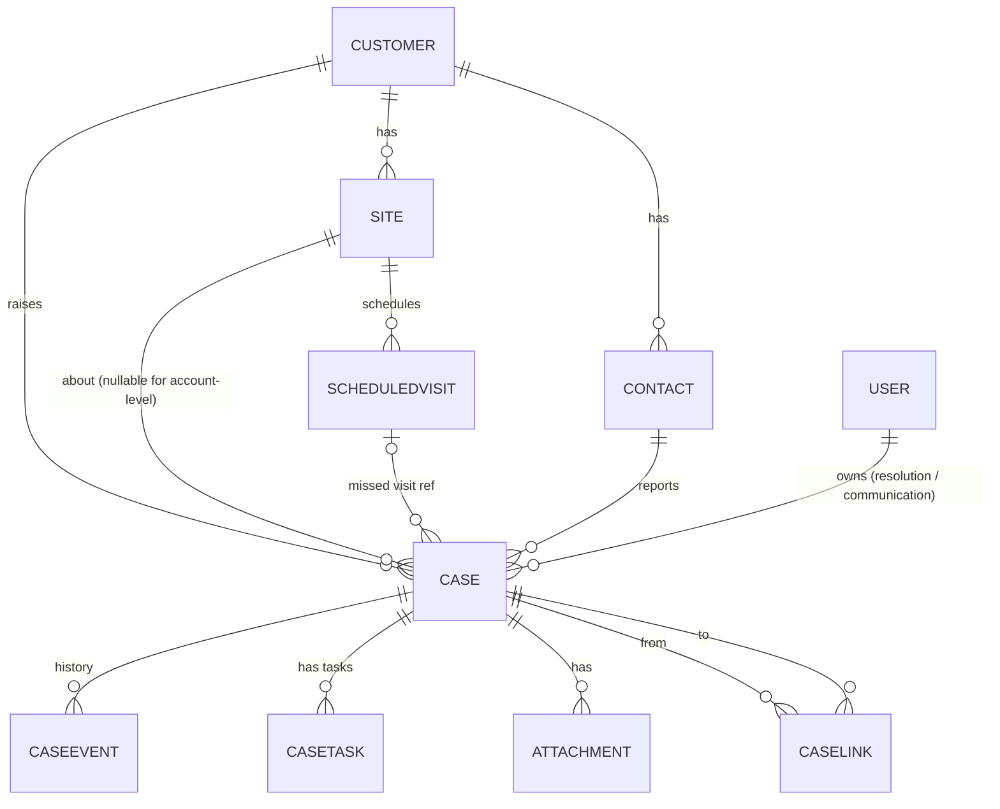

# Phase 7 — Data Model (minimum to support the workflow)

**Principle:** reuse PadCareOne's existing records `[A-01]` `[A-02]`. Add **five** module tables. History lives in **one append-only event log**, not separate history tables `[D-39]`.

## 1. Entities

| Entity | New / existing | Purpose | Key fields |
|---|---|---|---|
| **Customer** | Existing `[A-01]` | Account | customer_id, name, status, cs_owner_id, kam_id (nullable), primary_city |
| **Site** | Existing `[A-01]` | Service location | site_id, **customer_id**, city, address, status |
| **Contact** | Existing / created at Log | Reporter / SPOC | contact_id, customer_id, name, phone, email, role |
| **User** | Existing | PadCare staff | user_id, role (CS, SE, OPS_CM, KAM, FIN), city, available (leave flag) |
| **ScheduledVisit** | Existing `[A-02]` | Service schedule | visit_id, site_id, scheduled_date, status (Scheduled / Completed / Rescheduled / Missed) |
| **Case** | **New** | The register | see §2 |
| **CaseLink** | **New** | Relationships between cases | link_id, from_case_id, to_case_id, link_type (Duplicate of · Recurrence of · Split from · Child of · Related), created_by, created_at |
| **CaseEvent** | **New** (append-only) | Status, owner, handoff, customer update, follow-up, severity, escalation, confirmation history; SLA clocks | event_id, case_id, event_type, actor_id, actor_role, occurred_at, from_value, to_value, reason, payload (JSON: e.g., the update text, the follow-up's contact, the handoff checklist) |
| **CaseTask** | **New** | Linked tasks (F-3) | task_id, case_id, task_type (SE visit · Site-record correction · Commercial approval · Installation · Other), owner_id, due_at, mandatory (bool), status (Open / Done / Cancelled), done_at, evidence_ref |
| **Attachment** | **New** | Files | attachment_id, case_id, task_id (nullable), purpose (Customer evidence · Resolution evidence · Other), file_type, size, uploaded_by, uploaded_at |
| SlaPolicy | **New** (config) | Targets from `sla_matrix.md` | target_id (R1…V4), case_type, severity, duration, calendar (calendar / business) |

The master prompt's other entities map as follows:
- *Assignment history, status history, SLA event, customer communication* → CaseEvent types.
- *Resolution record, customer confirmation* → Case fields (current state) + CaseEvent (history).

## 2. Case — fields (mirrors `intake_form_spec.md`)

| Group | Fields |
|---|---|
| Identity | case_id (PK, `PC-YYMM-NNNNN`), logged_at, logged_by |
| Source | channel, received_at, prior_ack_at, source_ref |
| Customer | customer_id (or unmatched_customer_name), site_id (nullable for account-level), site_unverified (bool), site_as_stated, city (derived) |
| Reporter | reporter_contact_id, copy_spoc (bool) |
| Classification | case_type, sub_category, classification_answers (Q1–Q5), not_logged_at_receipt (bool) |
| Type-specific | location_on_site, scheduled_visit_id, invoice_no, invoice_month, disputed_amount, expected_outcome, customer_can_process (bool), correct_address, effective_date, quantity, requested_by_date, committed_date, current_problem_reported (bool), commercial_approval_needed (bool), sites_affected (array), customer_asks_for |
| Severity / priority | hygiene_exposure_now, sites_affected_count, recurrence_count, system_severity, final_severity, override_reason, expedite (bool), expedite_reason |
| Ownership | **resolution_owner_id**, **pending_owner_id** (during `Assigned`), **communication_owner_id**, escalation_level |
| Lifecycle | status, triaged_at, resolved_at, closed_at, closure_reason, reopen_count, rejection_count, followup_count, customer_chased (bool) |
| Resolution | evidence_type, evidence_refs (invoice/credit-note numbers, visit_id), root_cause_note, next_visit_confirmed_date |
| Confirmation | confirmation_outcome (Confirmed · Confirmed on site · Rejected · No response), confirmed_by_contact_id, confirmed_at |

## 3. Relationships

## 4. Constraints (enforced in the database or service layer)

| # | Constraint | Supports |
|---|---|---|
| K1 | `case.site.customer_id = case.customer_id` | VR-02, C-2 |
| K2 | If status ≠ Closed → `resolution_owner_id` NOT NULL and `communication_owner_id` NOT NULL | C-4: never ownerless |
| K3 | status = Assigned ⇔ `pending_owner_id` NOT NULL | 3.2 handoff |
| K4 | status = Closed → `closure_reason` NOT NULL; closure_reason ∈ {Confirmed, Confirmed on site} → evidence_refs NOT EMPTY | C-5, VR-33 |
| K5 | `received_at ≤ logged_at` | VR-05, D-25 |
| K6 | CaseLink: from ≠ to; both cases same customer; at most one *Duplicate of* per case | VR-10, D-14 |
| K7 | CaseEvent is insert-only (no update/delete) | Audit; reliable metrics |
| K8 | Case type ≠ Service request → final_severity NOT NULL after triage; billing → final_severity ≠ Hygiene-Critical | D-17, F-12 |
| K9 | Status enquiries never create Case rows; they create `followup_received` events on the parent | D-10 |
| K10 | No `Awaiting Confirmation` while a task with mandatory = true is Open | F-3 |

## 5. Event types (CaseEvent.event_type)
`case_logged`, `site_flagged_unverified`, `classified`, `reclassified`, `linked`, `severity_set`, `severity_overridden`, `expedited`, `customer_update_sent` (payload: includes_case_ref), `followup_received`, `handoff_initiated`, `handoff_accepted`, `handoff_returned`, `task_created`, `task_done`, `status_changed`, `hold_started`, `hold_ended`, `escalated` (payload: trigger, decision), `resolution_recorded`, `confirmation_requested`, `confirmed`, `rejected`, `no_response_closed`, `closed`, `reopened`, `unauthorised_attempt`.
