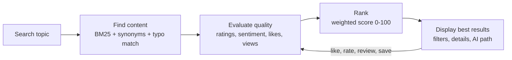
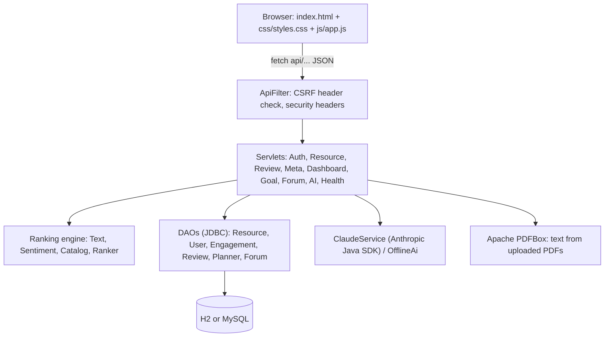

# GyaanSetu

**Discover the best educational content in one place, ranked by relevance, ratings, sentiment and engagement.**

GyaanSetu is a working prototype for the "find the best learning resource" problem. Learners search a topic, and the server
finds matching videos, PDFs, articles, tutorials and images, scores each one on quality, and shows the best first.
Learners can like, rate, review and save resources, and every action is stored in the database and changes the ranking for everyone.

- **Backend:** Java 17+, Jakarta Servlets 6 (Tomcat 10.1), plain **JDBC** with prepared statements, H2 or MySQL
- **Frontend:** HTML, CSS and vanilla JavaScript (no framework), served by the same server
- **AI:** Claude through the official Anthropic Java SDK, with a built-in offline engine when no API key is set

---

## Run it

**Easiest (only Java 17+ needed):** download `GyaanSetu.zip`, extract it, and start
`START-WINDOWS.bat` (Windows), `Start GyaanSetu (Mac).command` (macOS) or `./start-mac-linux.sh` (Linux).
The browser opens by itself. Build that zip from source with `./build-dist.sh`.

**Docker:** in the extracted folder, `docker build -t gyaansetu . && docker run -p 8080:8080 -v gyaansetu-data:/data gyaansetu`

**From source** (Java 17+ and Maven 3.8+):

```bash
./run.sh            # macOS / Linux
run.bat             # Windows
# or directly:
mvn compile exec:exec
```

Open **http://localhost:8080**. The first start creates the database and loads the sample data automatically.

| Demo account | |
|---|---|
| Email | `demo@gyaansetu.in` |
| Password | `demo1234` |

The login page also has **Continue as guest** and **Sign up**.

### Optional settings (environment variables)

| Variable | Default | Purpose |
|---|---|---|
| `PORT` | first free port from 8080 | HTTP port |
| `NO_BROWSER` | not set | Set to `1` to stop the browser opening automatically |
| `DB_URL` | H2 file at `~/gyaansetu-data/gyaansetu` | Any JDBC URL. H2 runs in MySQL mode |
| `DB_USER` / `DB_PASSWORD` | `sa` / empty | Database credentials |
| `ANTHROPIC_API_KEY` | not set | Turns on Claude for the AI features. Without it, the offline engine answers |
| `AI_MODEL` | `claude-opus-5-5` | Claude model used by the server |

**Use MySQL instead of H2:**

```bash
mysql -u root -p -e "CREATE DATABASE gyaansetu CHARACTER SET utf8mb4"
DB_URL="jdbc:mysql://localhost:3306/gyaansetu" DB_USER=root DB_PASSWORD=secret ./run.sh
```

The tables are created from `src/main/resources/schema.sql` (the same SQL works on H2 and MySQL), and the data is seeded on first run.

**Reset the demo data:** stop the server and delete the `~/gyaansetu-data` folder.

### Deploy to a standalone Tomcat 10.1

```bash
mvn package                 # builds target/gyaansetu.war and runs all tests
cp target/gyaansetu.war $CATALINA_HOME/webapps/
```

The app then runs at `http://localhost:8080/gyaansetu/`. The frontend uses relative URLs (`api/...`), so it works under any context path.

---

## Workflow (what the prototype demonstrates)



## Architecture



```
src/main/java/com/gyaansetu/
  Launcher.java            embedded Tomcat for local runs
  db/        Config, Database (JDBC DataSource + schema), Seeder (sample data)
  engine/    Text (tokenise, stem, typo match), Sentiment, Resource, Catalog, Ranker
  dao/       ResourceDao, UserDao, EngagementDao, ReviewDao, PlannerDao, ForumDao
  ai/        ClaudeService (Claude via the SDK), OfflineAi (rule-based fallback)
  web/       ApiServlet (base class), ApiFilter (CSRF), AppListener (startup), Views, RankContext, Passwords
  servlet/   one servlet per API area
src/main/resources/schema.sql, seed/resources.json
src/main/webapp/           index.html, css/, js/, WEB-INF/web.xml
src/test/java/             EngineTest (unit), ApiIntegrationTest (boots Tomcat and calls the API over HTTP)
```

## Ranking algorithm

Every resource gets six signals, each scaled to 0..1, combined as a weighted average:

`score = Σ wᵢ · sᵢ / Σ wᵢ` (shown as 0-100)

| Signal | Default weight | How it is computed |
|---|---|---|
| Relevance | 40 | BM25 over title (×3), tags (×2), subject, source, description. Query expansion with a concept map (`ml` → machine learning, `ww2` → world war ii), prefix matching and one-typo tolerance (`calclus` → calculus). Phrase and coverage bonuses |
| Rating | 20 | Bayesian average `(C·m + Σstars) / (m + n)` with m = 25, so 5 stars from 3 people does not beat 4.8 from 3,000 |
| Sentiment & feedback | 15 | 60% average sentiment of reviews (lexicon scorer with negation: "not useful" is negative) + 40% "was this helpful" votes |
| Likes per view | 15 | Smoothed like rate `(likes + m·global) / (views + m)` |
| Views | 10 | `log10(views)` scaled to the most viewed resource |
| For you | 5 | Overlap of the resource's subject and tags with what the learner liked, saved, completed or rated 4+ |

Relevance only applies when there is a search query. "For you" only applies once the learner has some activity.
The weights can be changed live from **Advanced filters & ranking weights** on the results page; they are sent to the server with each search.

**Demo tip:** search `machine learning`. The sample set includes a clickbait video with 14.5M views, but its 2.9★ rating and
negative comments keep it out of the top results. Set every weight except Views to 0 and watch it rise.

## Features

| Screen | What works |
|---|---|
| Home | Search with autocomplete, content-type shortcuts, popular subjects, trending searches, top-ranked and recommended resources |
| Search results | Ranked list, quality score with signal breakdown bar, filters (type, subject, rating, sort, level, popularity), live ranking weights, save |
| AI learning path | Orders the best results from beginner to advanced with a reason per step |
| Content details | Preview, open on source, save, like, mark complete, quality gauge with checklist and score table, rating distribution, reviews with sentiment, helpful votes, related resources |
| AI Study Assistant | Upload PDF/TXT/MD (read on the server with PDFBox), paste text or pick a resource; Summary, Key Points, Q&A chat and Quiz |
| Dashboard | Stats, recent searches, recommendations, My Library, study planner with AI weekly plan, leaderboard |
| Community | Ask questions, upvote, answer, AI-drafted answers, related resources per question |
| Login / Sign up | Sessions, PBKDF2 password hashing, guest accounts, demo account |
| Mobile | Responsive layouts and a bottom tab bar |

## API

All endpoints return JSON. Requests that change data must send the header `X-Requested-With: GyaanSetu` (CSRF protection).

| Method | Path | Purpose |
|---|---|---|
| GET | `/api/health` | Server and database status |
| GET | `/api/meta` | Subjects, types, trending searches, suggestions, AI mode, totals |
| GET | `/api/resources?q=&types=&subject=&level=&minRating=&minViews=&sort=&w=&limit=` | Ranked search |
| GET | `/api/resources/recommended` | Personalised picks |
| GET | `/api/resources/{id}?q=` | Details, reviews, related, score checks (counts a view) |
| POST | `/api/resources/{id}/like` \| `save` \| `complete` | Toggles (sign-in required) |
| POST | `/api/resources/{id}/rate` `{stars}` | Rate 1-5, `0` removes |
| POST | `/api/resources/{id}/feedback` `{value: "yes"\|"no"\|""}` | Helpful vote |
| POST | `/api/resources/{id}/reviews` `{body}` | Post or update your review |
| POST | `/api/reviews/{id}/vote` | Upvote a review |
| GET / DELETE | `/api/dashboard`, `/api/dashboard/searches` | Dashboard data, clear history |
| GET / POST / PUT / DELETE | `/api/goals`, `/api/goals/{id}`, `POST /api/goals/plan` | Study planner |
| GET / POST | `/api/threads`, `/api/threads/{id}`, `/answers`, `/vote`, `/draft` | Community forum |
| POST | `/api/ai/upload` (multipart `file`), `/summary`, `/keypoints`, `/quiz`, `/ask`, `/path` | AI features |
| GET / POST | `/api/auth/me`, `/signup`, `/login`, `/guest`, `/logout` | Accounts |

## Tests

```bash
mvn test
```

- **EngineTest**: tokenising, stemming, typo matching, sentiment with negation, password hashing, ranking rules
  (clickbait does not win, filters, sorting, score bounds, personalisation).
- **ApiIntegrationTest**: starts Tomcat on a free port with an in-memory database and calls every API area over HTTP:
  security rules (CSRF 403, sign-in 401, validation 400, duplicate email 409), engagement counters, one review per learner,
  views, dashboard, goals, AI planner, forum, offline AI, text and PDF upload, unknown paths returning JSON 404.

## Security notes

- Passwords: PBKDF2-HMAC-SHA256, 120,000 iterations, random salt. Plain passwords are never stored or logged.
- Sessions: HttpOnly, SameSite=Lax cookie, session id rotated on sign-in.
- CSRF: every state-changing request needs a custom header that other sites cannot send without a CORS preflight.
- SQL: prepared statements everywhere; table names are never taken from user input.
- Uploads: 25 MB limit, only PDF/TXT/MD/CSV/JSON accepted, text extracted on the server.

## Data

The 46 resources and their links are real open educational sources (freeCodeCamp, MIT OpenCourseWare, OpenStax, Khan Academy,
3Blue1Brown, Wikipedia, MDN, Harvard CS50 and others). **Views, likes, ratings and the seed reviews are sample figures** for the prototype.
The community members on the leaderboard and the demo account are sample users.
